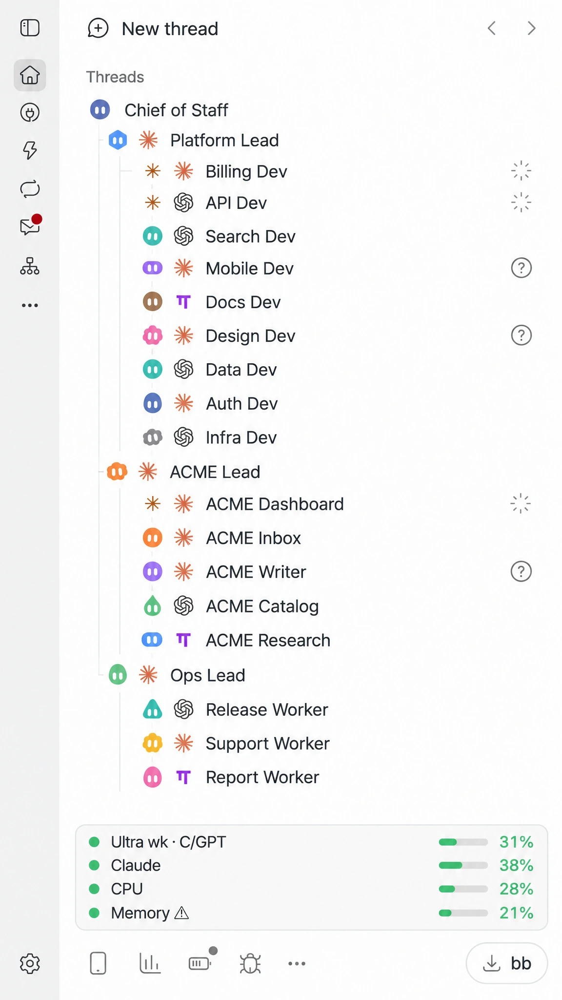
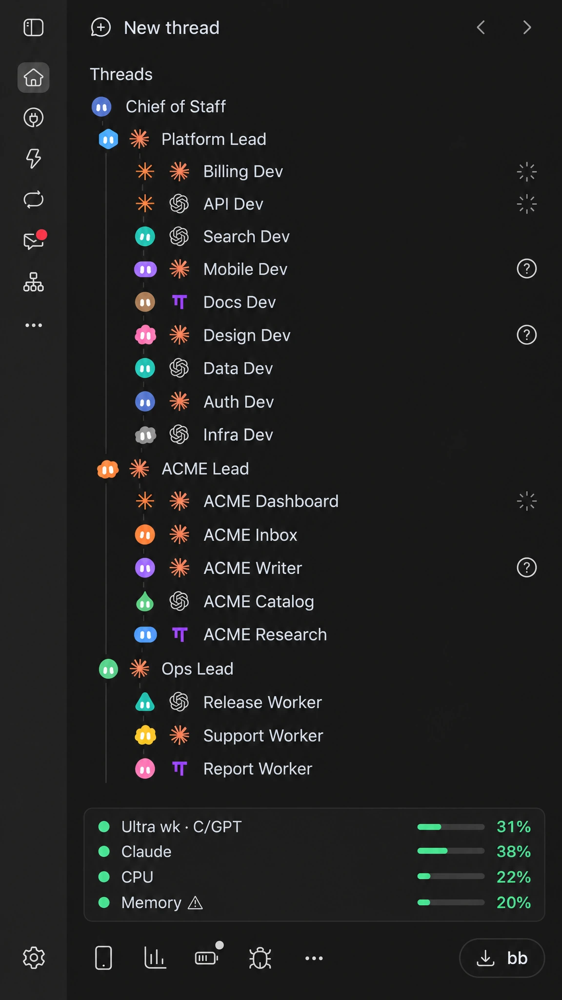
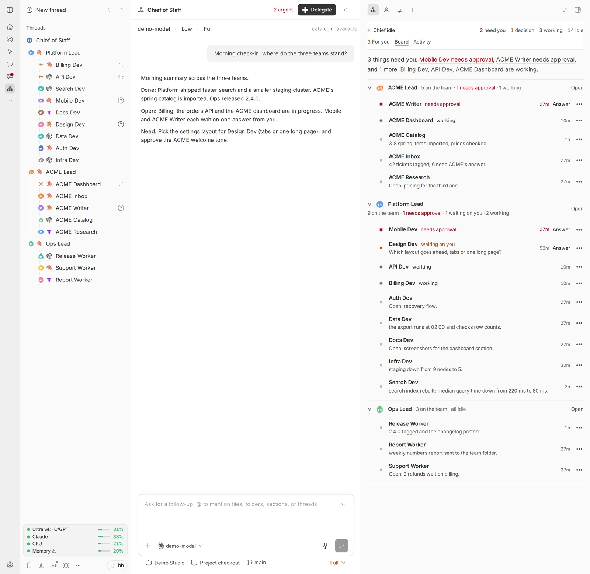
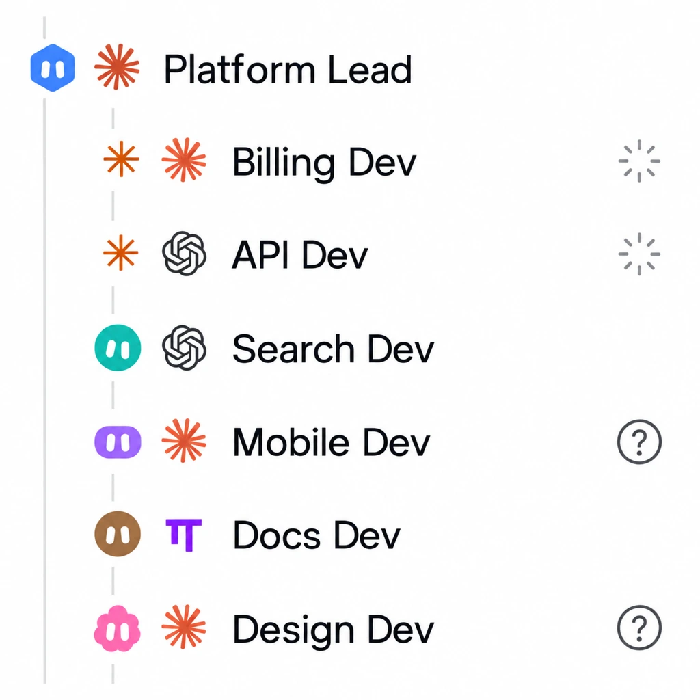
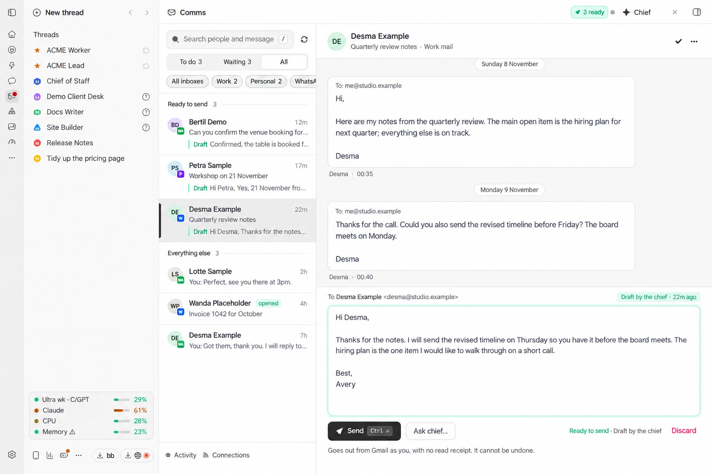
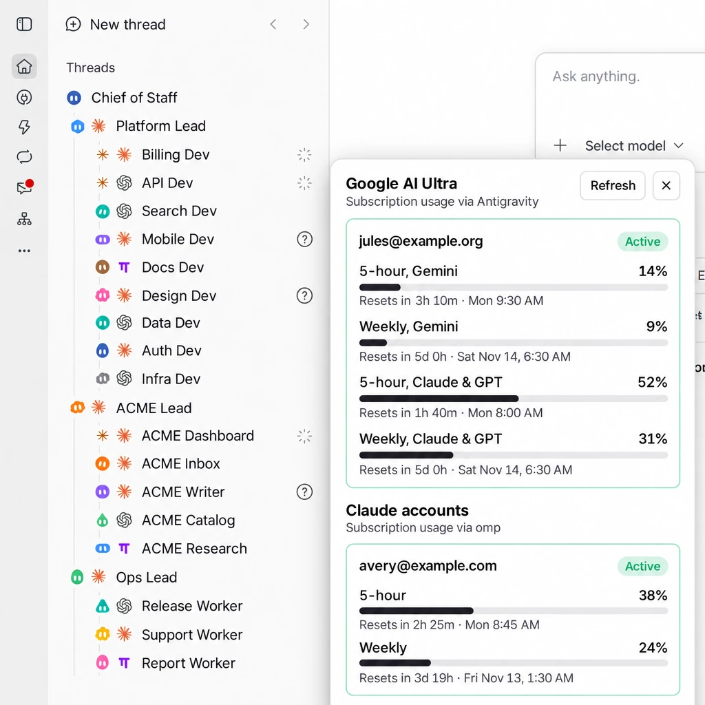

# bb-plugins-public

Seven plugins for [bb](https://getbb.app), the agent workspace. Together they turn bb into a small
command centre: one **chief** thread that hands work to reusable **worker** threads and tells you
what needs you, a coloured **face** beside every thread, a **mail and WhatsApp inbox** where agents
write drafts and you press Send, **image and video generation**, a **usage strip** for your model
subscriptions, and a **screen share** for logging in to websites by hand.

You can install all seven or just one. Each plugin has its own `README.md` with the details; this
page is the map.

Licence: MIT (see `LICENSE`). `usage` is based on an MIT plugin by another author and keeps that
author's attribution.

<table>
<tr>
<td></td>
<td></td>
</tr>
</table>

## The hierarchy: chief, managers, workers

The lead picture is bb's sidebar with the plugins installed. It is a tree, and the tree is the
idea:

- **The chief** ("Chief of Staff", top row) is one long-lived thread. You talk to it. It never does
  the work itself: it decides who should, briefs them, and tells you only what needs you.
- **Managers** ("Platform Lead", "ACME Lead", "Ops Lead") each own a team. A manager is a thread of
  its own that breaks a topic up, briefs its workers and reports one summary upward. Use one per
  client, product or area.
- **Workers** ("Billing Dev", "ACME Inbox", "Release Worker" and so on) are reusable threads, one
  per topic. A worker keeps its context, so you can send it more work next week. Each has its own
  face, and a mark for the model provider it runs on.

Every worker ends a turn with `Done:`, `Open:` and `Need:` lines. The chief and the managers read
those lines, so you read one board instead of every thread. The rows show state at a glance: a
working star, a question mark when a thread waits for an answer, a quiet dot when it is idle.

The tree lines are bb's own thread nesting: the plugin links each worker to its manager and each
manager to the chief when it creates them (`bb cos delegate`, or the chief does it for you).



All screenshots in this README show invented data: the people, projects, threads, mail, accounts and
usage numbers do not exist. They were taken in a throwaway bb with made-up content (only the small CPU
and memory readings in the sidebar strip are a real machine's load).

## What is in it

| Plugin | What it does |
|---|---|
| [`chief-of-staff`](chief-of-staff/README.md) | One long-lived "chief" thread manages your work by delegating to worker threads, which can sit under manager threads. A side panel shows the roster, a "For you" list of decisions, a board and activity. `bb cos` does the same from a shell. |
| [`faces`](faces/README.md) | A small coloured face beside every thread in the sidebar. It turns into an animated star while the thread works, fades while it waits for you, and stays calm when idle. |
| [`chief-of-comms`](chief-of-comms/README.md) | Gmail and WhatsApp as one inbox. A "Chief of Communications" thread drafts replies; nothing is sent until you press Send. |
| [`comfy-cloud`](comfy-cloud/README.md) | Generate images and video on Comfy Cloud from bb, keep every result next to the workflow that made it, browse them in a panel. |
| [`proxy-usage`](proxy-usage/README.md) | A strip in the sidebar footer with your subscription usage per signed-in account, plus server health. Can resume a turn that stopped on a usage limit once the window reopens. |
| [`usage`](usage/README.md) | A dashboard of token use and estimated cost by agent, model and project, across machines. |
| [`screen-share`](screen-share/README.md) | One click opens a live view of the agent browser so you can log in by hand from a laptop or phone, instead of typing credentials into a chat. |

### Faces

Each thread gets a face the first time it shows in the sidebar and keeps it, so you tell threads
apart by sight. Tree lines, faces, provider marks and state marks together:



### The chief's "For you" list

The Board lists what each manager and worker reports. The **For you** tab is shorter: only the
chief adds to it, one item at a time, and each item has buttons. Answer there, or from a shell with
`bb cos board`.

### Mail and WhatsApp with approve-before-send

Agents write drafts; you read them next to the conversation and press Send.



### The usage strip

The strip at the bottom of the sidebar shows how much of each subscription window is used; click it
for every window and when it resets.



## What you need

- **bb 0.48.1 or later.** (`faces` needs it; the others work on older bb, see each README.)
- **Node 22 and npm** on the machine that runs the bb server, for the install step.
- **A provider bb can run threads on**, for `chief-of-staff` and `chief-of-comms`: any provider you
  already use in bb (for example Claude Code, Codex, or omp through the ACP provider). The plugins
  do not need a particular one; the chief and new workers use bb's project default until you set
  `chiefProviderId`, `chiefModel`, `workerProviderId` and `workerModel`.

What each plugin needs beyond that:

| Plugin | Extra requirements |
|---|---|
| `faces` | Nothing. No login, no other plugin. |
| `chief-of-staff` | A provider (above). Optional: the `sqlite3` command-line tool, so a moved thread keeps its place in the sidebar tree. |
| `chief-of-comms` | **Mail:** a `gw` command-line tool that talks to Gmail and returns JSON (it is not part of this repo; the subcommands the plugin calls are listed in its README), and two accounts called `work` and `personal`. **WhatsApp:** a phone to link as a device. **Optional:** a Superhuman login for read receipts and undo send; a drafting-style skill named `unslop`. Without `gw` the WhatsApp half still works. |
| `comfy-cloud` | A Comfy Cloud account with an API key and credits (generation is billed to it). `ffmpeg` and `ffprobe` on the server. |
| `proxy-usage` | omp installed at `~/.local/bin/omp` and signed in to one or more model accounts; Linux with systemd for the server-health rows. |
| `usage` | Node on each machine whose usage you want to count. It reads the agents' own local logs; Cursor and OpenCode Go also call their vendor's usage endpoint with your own local login (see its README). |
| `screen-share` | Linux with systemd, an X display with a browser on it, `x11vnc`, `websockify`, `novnc`, the `tailscale` CLI with HTTPS certificates, and passwordless sudo for two commands. The host files are in `screen-share/host`. |

## Install

Install one plugin straight from this repository. `.bb/plugins.json` lists all seven, so bb can
pick the folder:

```sh
bb plugin install git:github.com/<owner>/bb-plugins-public --plugin faces --yes
```

Replace `<owner>` with the account that hosts this repository. Install more the same way:

```sh
for p in chief-of-staff chief-of-comms comfy-cloud proxy-usage usage screen-share; do
  bb plugin install git:github.com/<owner>/bb-plugins-public --plugin "$p" --yes
done
```

From a clone, a plugin folder installs as a path. Install its packages first, because the
install builds the panel and needs them:

```sh
git clone https://github.com/<owner>/bb-plugins-public
cd bb-plugins-public/chief-of-staff
npm ci --ignore-scripts
bb plugin install "$PWD" --yes
bb plugin list            # the plugin should say "running"
bb plugin logs chief-of-staff
```

`chief-of-staff` also draws its own avatar on worker rows (setting `sidebarFaces`). If a worker row
shows two faces once `faces` is installed, set `sidebarFaces` to `off` in `chief-of-staff`.

A plugin that needs a login or a tool shows `needs-configuration` or works only in part until you
provide it. `bb plugin update <id>` brings in later versions.

## Your first ten minutes

1. **Install `faces` and `chief-of-staff`** (two commands above). The sidebar shows a face beside
   each thread within a few seconds; reload the bb window if it does not.
2. **Set the provider.** In bb, open Settings, Extensions, Chief of Staff, and fill in
   `chiefProviderId`, `chiefModel`, `workerProviderId` and `workerModel` with what you use. Or from a
   shell: `bb plugin config chief-of-staff set chiefProviderId <id>`.
3. **Start the chief.** Run `bb cos start`. It creates the "Chief of Staff" thread (or resumes
   it); open the panel from the sidebar to see the roster.
4. **Give it work.** Tell the chief, in plain words, what you want done in one of your projects. It
   creates a worker for the topic. You can also do it by hand:
   `bb cos delegate <project> <worker-name> "<what to do>" --spawn`.
5. **Watch the roster.** The Board tab shows each worker's last `Done`, `Open` and `Need`. `bb cos
   roster` prints the same list.
6. **Answer what needs you.** The chief puts the items that need *you* on the "For you" tab, each
   with buttons; click one. A worker's own `Need:` line shows on the Board tab. From a shell:
   `bb cos board` lists the items and `bb cos board resolve <id>` or `dismiss <id>` closes one.
   A worker stopped on a permission prompt or a question shows under `bb cos decisions`;
   answer it with `bb cos answer <worker> allow|deny|answer`.
7. **Add the rest when you want it.** `usage` and `proxy-usage` need nothing but your local
   logins. `comfy-cloud` needs a key: `bb plugin config comfy-cloud set keyFile /path/to/.env`, then
   `bb comfy status`. `chief-of-comms` is the largest setup: install its `gw` tool and link
   WhatsApp from the panel's Connections tab.

## Settings you will want to change

- `chief-of-staff`: the four provider and model settings (blank means bb's project default);
  `memoryRoot` if you keep agent notes somewhere other than `~/agents`; `worktreeRoots` if some
  projects need a worktree per worker. Clock times are in UTC; change `HOME_TIME_ZONE` in `core.ts`
  to your zone (the README of the plugin lists the three places).
- `chief-of-comms`: `gwCommand`, `workEmail`, `personalEmail`, and `gwWorkAccount` and
  `gwPersonalAccount` if your `gw` knows the accounts under other names; `mailSendVia` (`gmail` if you
  do not use Superhuman). Times are shown in UTC.
- `comfy-cloud`: the API key (secret setting or key file), the default image and video model.
- `proxy-usage`: `OMP_BIN` in `server.ts` if omp is not at `~/.local/bin/omp`; the watchdog unit name
  if you watch one.
- `screen-share`: the display number in the unit file and `CHROME_PATTERN` in `server.ts`.

## Run the tests

Each plugin is its own npm package with its own lockfile:

```sh
cd <plugin>
npm ci --ignore-scripts
npm rebuild better-sqlite3      # plugins that keep a database
npm test                        # screen-share has no tests; run: npx tsc -p tsconfig.json --noEmit
```

## Remove a plugin

```sh
bb plugin remove <id>
```

This also deletes the plugin's settings and secret settings, so export anything you want to keep
first. To stop a plugin without losing its settings, disable it instead: `bb plugin disable <id>`.
Each plugin keeps its data in its own folder under bb's data directory; removing the plugin does not touch
your mail, your projects or your model logins.

## Not included, on purpose

This is a cut of a larger personal setup. Features that depended on one person's clients, banks,
private files or accounts were removed rather than rewritten, and some plugins from that setup are not
here at all. `chief-of-staff` has no auto-titling, no automatic board staleness check and no
model-written handover summary: they needed a model call made with your own login, which a shared
plugin should not do. Use bb's own cloud titles, and close board items yourself (`bb cos board resolve
<id>` or `dismiss <id>`).

## Reporting a problem

Open an issue on the repository. Do not paste real names, addresses or keys into an issue.
