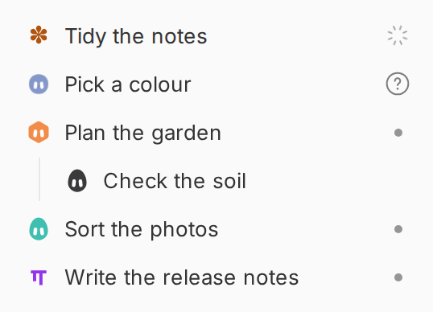
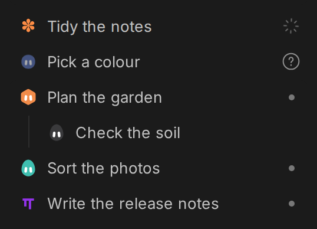

# Faces

Faces puts a small face beside every thread in bb's sidebar. While a thread works, its face turns into a small animated star. While the thread waits for you to answer a question or approve a step, the face fades in and out. When the thread is idle, the face is still.





Each face is a coloured shape with two eyes. There are 10 shapes and 12 colours, so 120 faces. A thread gets its face the first time it shows in the sidebar and keeps it. Two threads in your sidebar never share a face while an unused one is left.

Faces works on bb 0.48.1. It needs no account and sends nothing off your machine. The plugin keeps each thread's face in its own database on your bb server.

## Install

From the bb-plugins-public repository (this folder is one plugin of several, so name it):

```
bb plugin install git:github.com/<owner>/bb-plugins-public --plugin faces
```

bb downloads what the plugin needs and builds it, so you need nothing else installed. `bb plugin update faces` brings in later versions.

From a folder on your computer, you first install the plugin's one library with npm, which needs Node.js:

```
cd /path/to/faces
npm install --omit=dev
bb plugin install /path/to/faces
```

The faces show in your sidebar a few seconds after the install. If they do not, reload the bb window.

## Change a face

Right-click a thread in the sidebar, or open its `...` menu, and choose Face:

- New face gives the thread a different face.
- Hide face takes the face away, and bb's usual icon for that thread comes back. Show face brings the face back.

The same works from a terminal, and an agent can run it for you:

```
bb faces                            every thread's face
bb faces set <thread id> teal egg   give a thread a face you choose
bb faces new <thread id>            give a thread a different face
bb faces hide <thread id>           take a thread's face away
bb faces show <thread id>           put a thread's face back
bb faces choices                    list the shapes and colours
```

Inside a thread you can leave out the thread id. An agent can run `bb faces set teal egg` to change the face of its own thread.

## Switch it off

```
bb plugin disable faces
```

The faces go away at once and bb's own icons come back. `bb plugin enable faces` turns them back on with the same faces. `bb plugin remove faces` uninstalls the plugin.

## How it works

bb has no official place for a picture at the start of a sidebar row. Faces therefore draws each face over the small icon bb shows at the start of the row for the thread's agent, and hides that icon while the face covers it. It finds the rows by `data-sidebar-thread-id`, the attribute bb documents for its row links, and the agent icon inside each row. It does not change your thread titles or the order of your threads.

The face follows bb's own status for the thread, so it changes as soon as bb's does.

If a later bb draws its rows differently and Faces cannot find the agent icon, it draws nothing rather than draw in the wrong place.

## For developers

```
npm install
npm test
```

`lib/faces.ts` holds the shapes, the colours and the rules for giving out faces. `components/paint.ts` draws them in the sidebar. `server.ts` stores them and runs `bb faces`.
